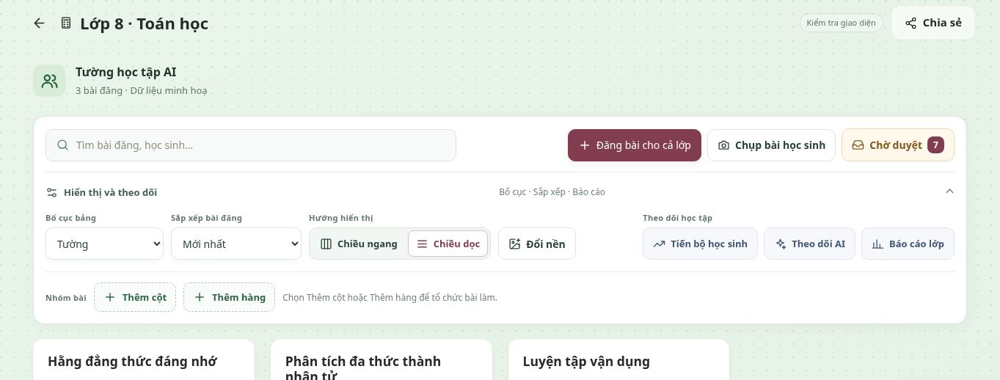

# Thanh công cụ bảng lớp

Thanh công cụ được sắp xếp theo công việc của giáo viên:

- Hàng chính: tìm bài, đăng bài cho cả lớp, chụp bài và chờ duyệt.
- Hiển thị và theo dõi: bố cục, sắp xếp, hướng hiển thị, đổi nền, tiến bộ và báo cáo.
- Nhóm bài: thêm cột hoặc hàng.

Trên điện thoại, công cụ phụ được thu gọn trong **Hiển thị và theo dõi**.
Nhấn tiêu đề này để mở hoặc thu gọn; trạng thái được giữ khi bảng vẽ lại
trong phiên làm việc. Trên màn hình rộng, nhóm này mở sẵn.

Học sinh chỉ thấy các điều khiển hiển thị được phép. Quyền đăng bài,
duyệt, báo cáo và quản lý nhóm vẫn theo quyền quản lý lớp hiện có.

Ảnh dưới dùng dữ liệu minh hoạ để kiểm tra bố cục:

Đã kiểm tra độ rộng 360, 390, 768, 1024, 1366 và 1920 px,
bao gồm mở công cụ trên điện thoại và thao tác bằng bàn phím.
